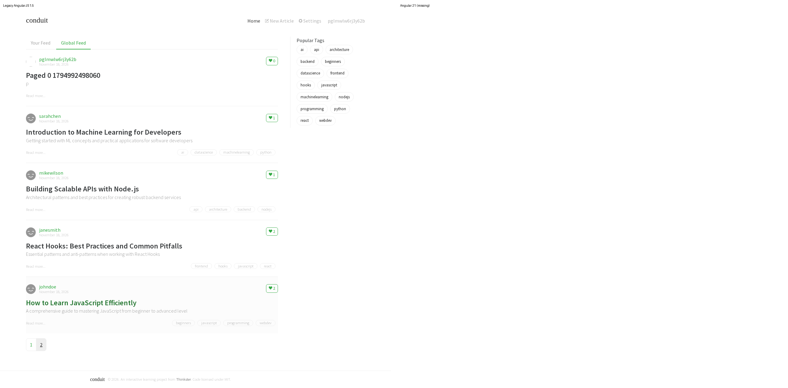
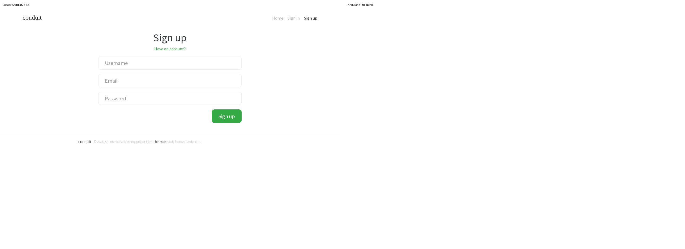
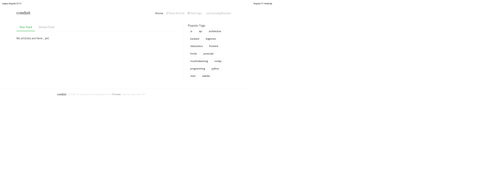
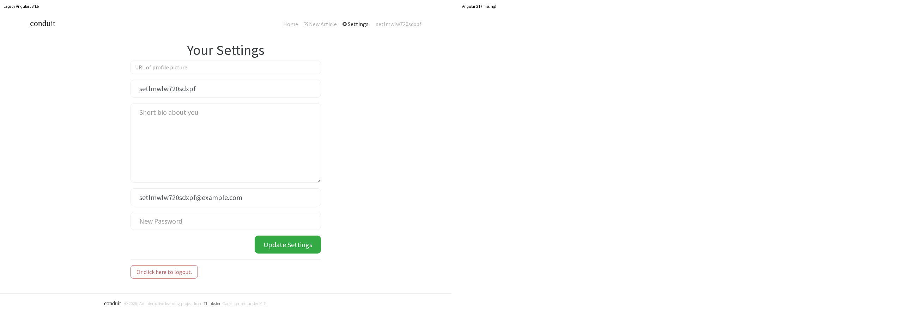
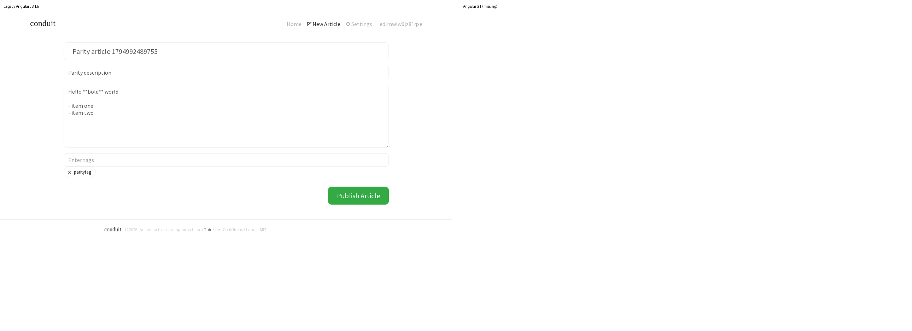
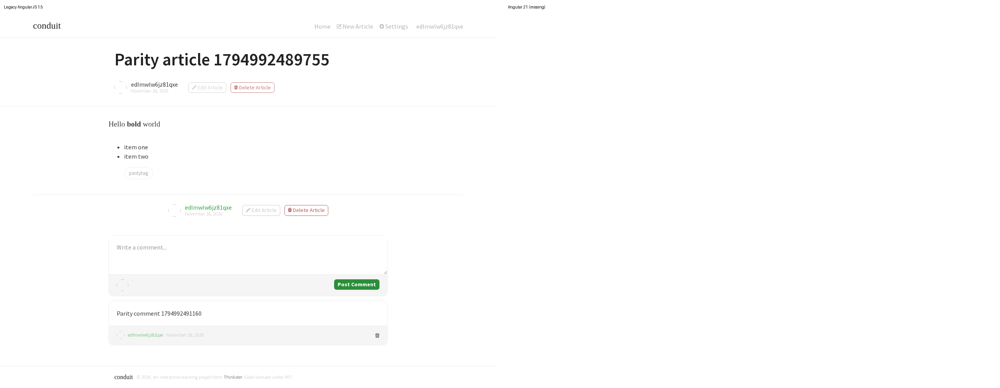
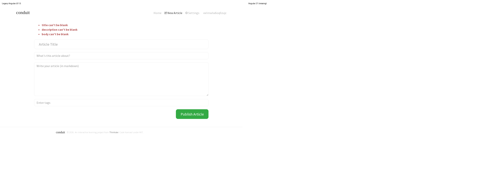
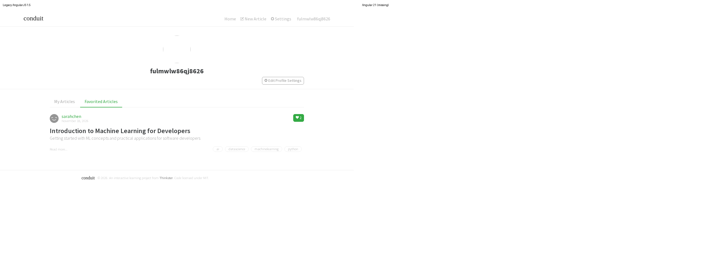
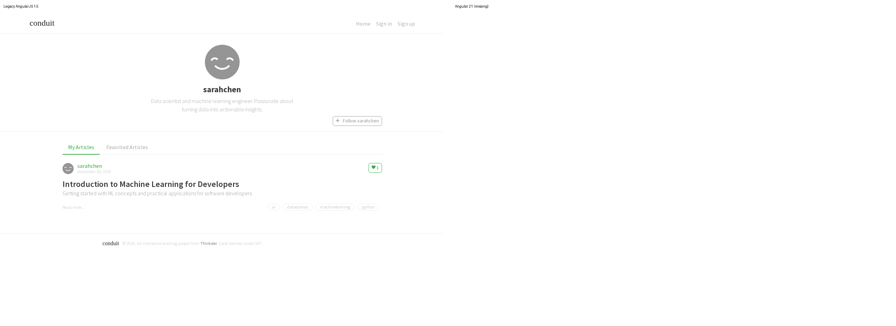
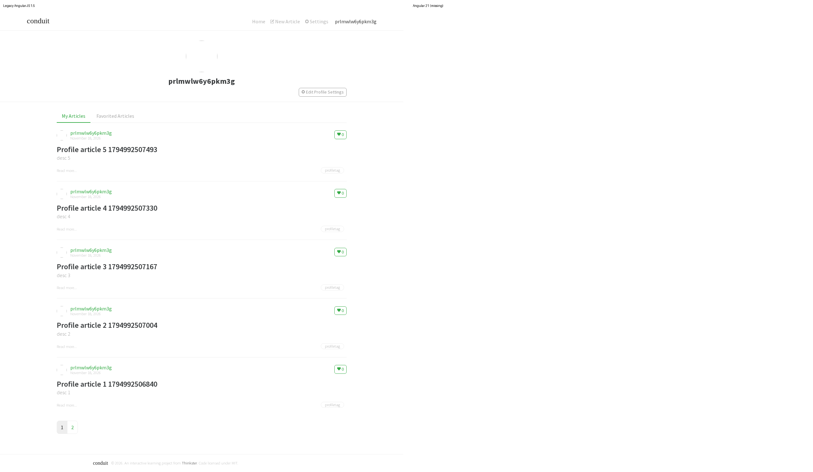

# Parity report: legacy AngularJS vs Angular 21

Generated by `python3 compose.py` from `report/results.json` and `report/screens/`.

| Spec | Legacy | Angular |
| --- | --- | --- |
| auth › sign in with wrong password shows errors | expected fail | - |
| home › tag filter shows tag tab and tagged articles | pass | - |
| social › favorite and unfavorite; favorites tab on profile | pass | - |

## Side-by-side screenshots (legacy left, Angular right)

### 01-home-global-feed

### 02-home-page-2

### 03-home-tag-filter

### 04-article-logged-out

### 05-register

### 06-home-logged-in-your-feed

### 08-settings

### 09-editor

### 10-article-own-with-comment

### 11-editor-errors

### 12-profile-favorites

### 13-your-feed-following

### 14-profile-other-user

### 15-profile-own-articles

