# Parity report

Same specs, two apps: `legacy` (AngularJS 1.5, http://localhost:4000, hash routes) and `angular` (Angular 21, http://localhost:4200).

Legacy: 31/31 pass · Angular: 31/31 pass

| Spec | Flow | Legacy | Angular |
|---|---|---|---|
| article.spec.ts | author sees markdown, edit and delete | pass | pass |
| article.spec.ts | favorite and follow from the article page | pass | pass |
| article.spec.ts | reader posts and deletes a comment | pass | pass |
| article.spec.ts | seed article for anonymous readers | pass | pass |
| article.spec.ts | unknown slug goes home | pass | pass |
| auth.spec.ts | blank sign up shows server errors | pass | pass |
| auth.spec.ts | sign in page and existing account | pass | pass |
| auth.spec.ts | sign up page and new account | pass | pass |
| auth.spec.ts | signed-in user is sent home from sign in | pass | pass |
| auth.spec.ts | wrong password keeps the user signed out | pass | pass |
| editor.spec.ts | anonymous users are sent home | pass | pass |
| editor.spec.ts | cannot edit someone else's article | pass | pass |
| editor.spec.ts | edit loads your article and saves the changes | pass | pass |
| editor.spec.ts | missing fields show server errors | pass | pass |
| editor.spec.ts | publish, edit and delete an article | pass | pass |
| home.spec.ts | favorite as anonymous goes to sign up | pass | pass |
| home.spec.ts | global feed, banner and popular tags | pass | pass |
| home.spec.ts | pagination | pass | pass |
| home.spec.ts | signed-in user starts on Your Feed | pass | pass |
| home.spec.ts | tag filter | pass | pass |
| layout.spec.ts | anonymous header, footer and title | pass | pass |
| layout.spec.ts | signed-in header | pass | pass |
| layout.spec.ts | unknown route falls back to home | pass | pass |
| profile.spec.ts | anonymous follow goes to sign up | pass | pass |
| profile.spec.ts | another user's profile, articles and follow | pass | pass |
| profile.spec.ts | favorite shows up on the Favorited Articles tab | pass | pass |
| profile.spec.ts | own profile lists own articles and empty favorites | pass | pass |
| profile.spec.ts | unknown profile goes home | pass | pass |
| settings.spec.ts | anonymous users are sent home | pass | pass |
| settings.spec.ts | form is prefilled and saves bio | pass | pass |
| settings.spec.ts | logout returns to anonymous header | pass | pass |

## Side by side (legacy left, Angular right)

### article-author

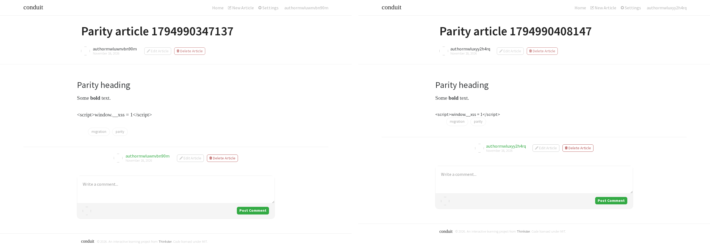

### article-comment

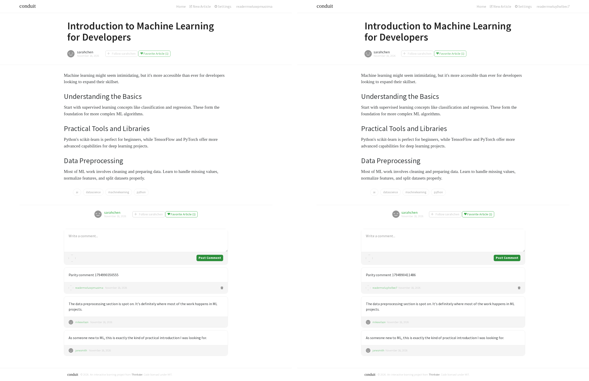

### article

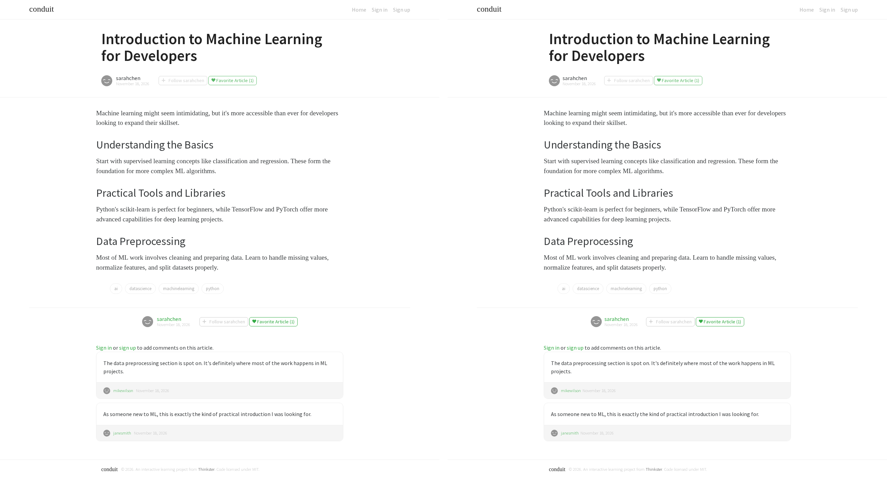

### editor-edit

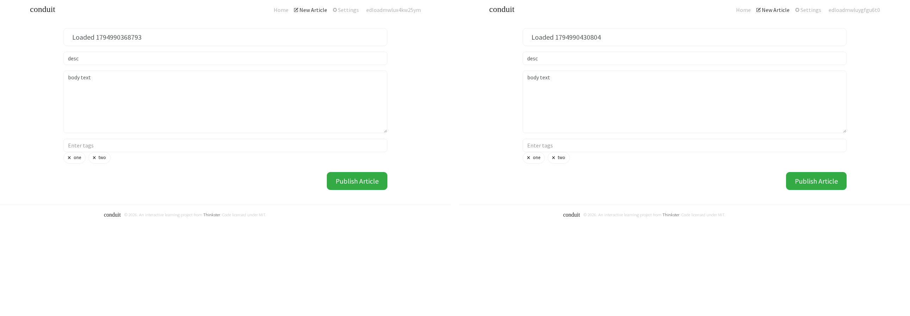

### editor

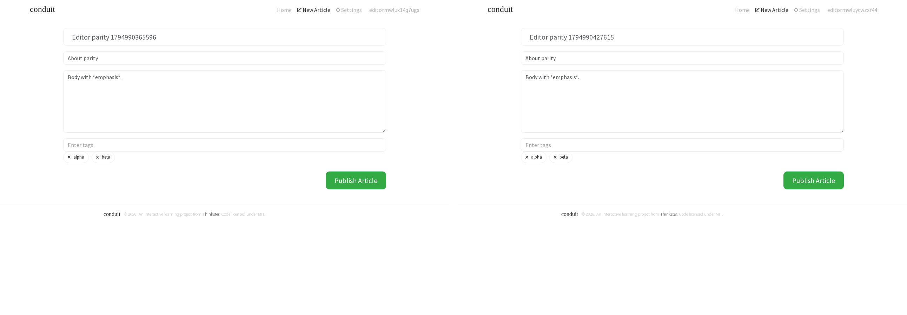

### home-pagination

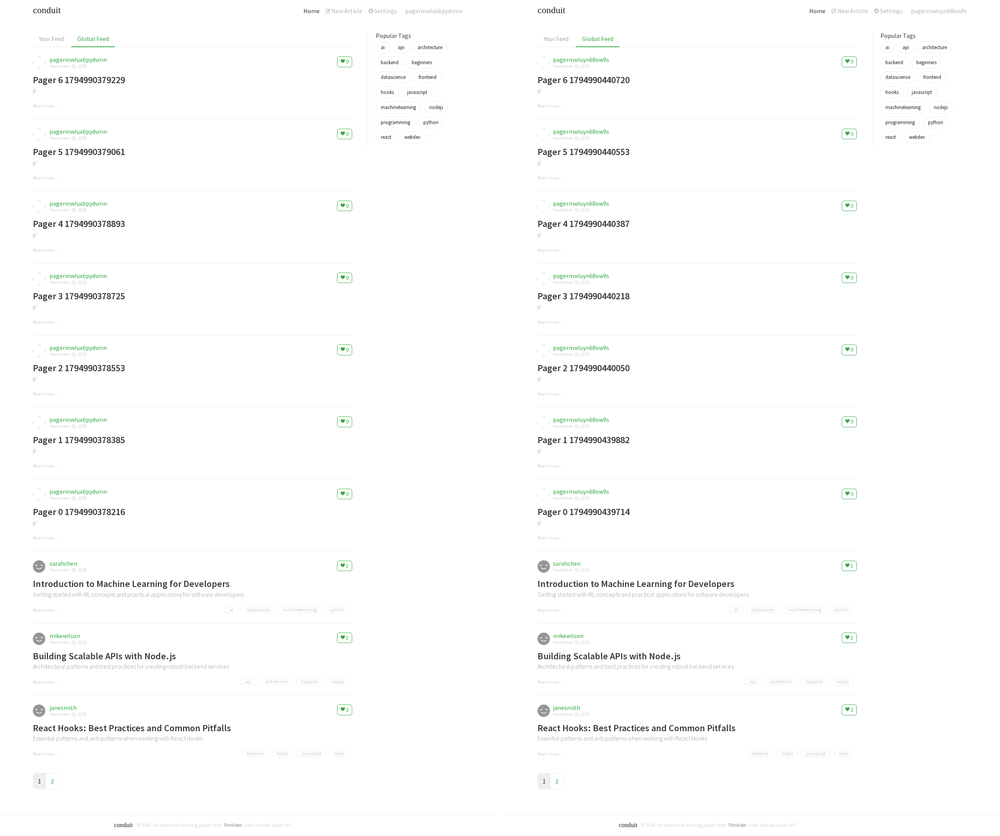

### home-tag

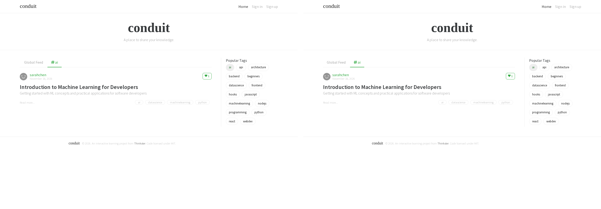

### home

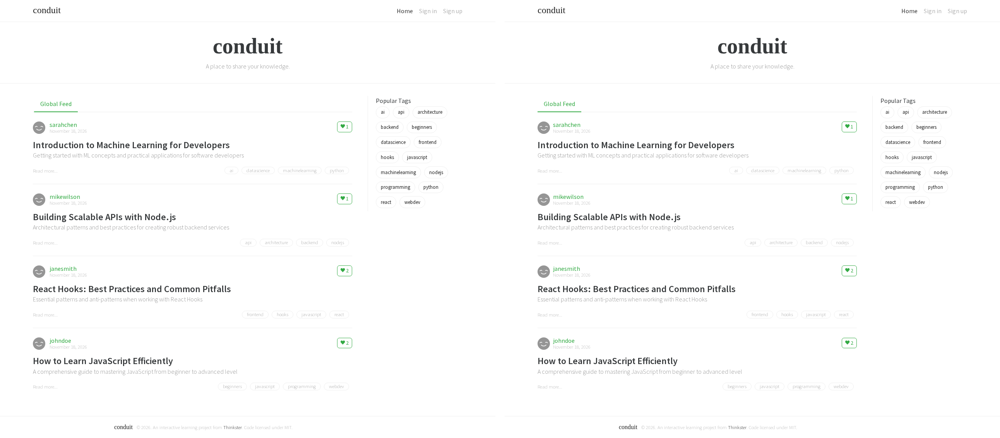

### layout-signed-in

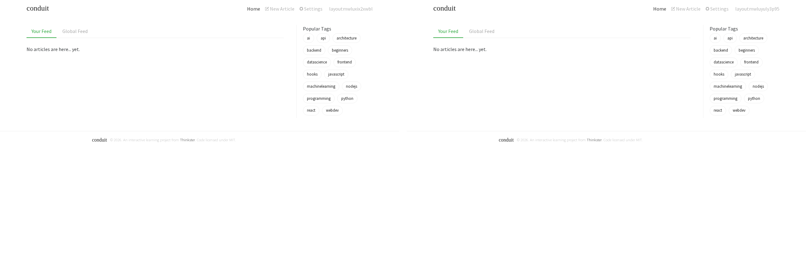

### login-error

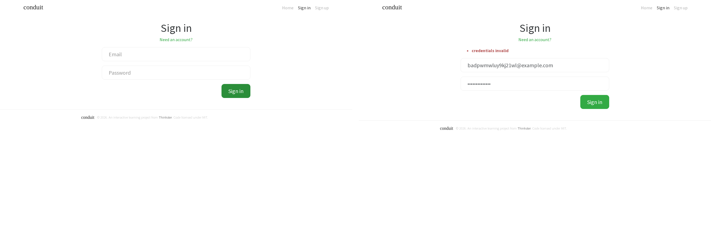

### login

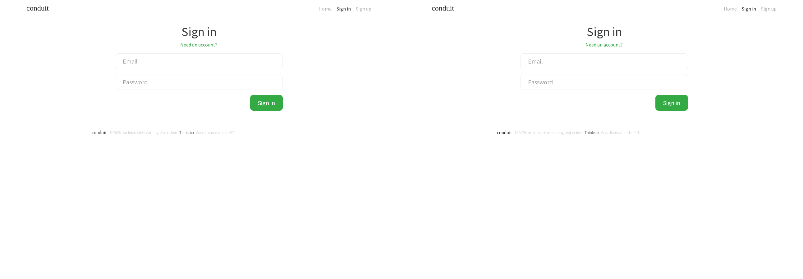

### profile-favorites

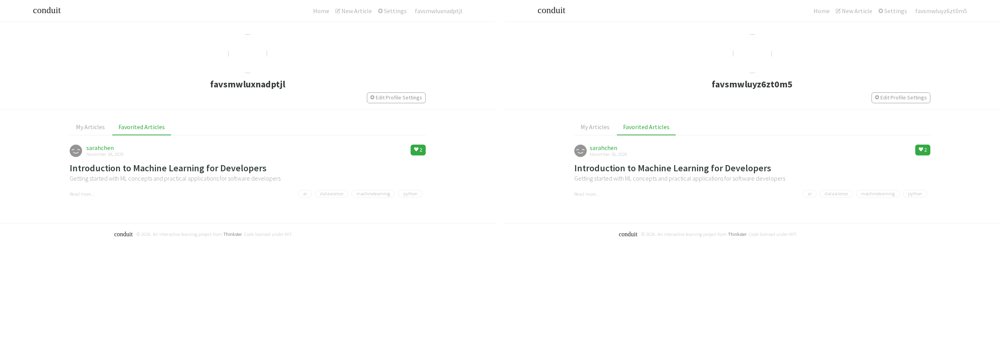

### profile

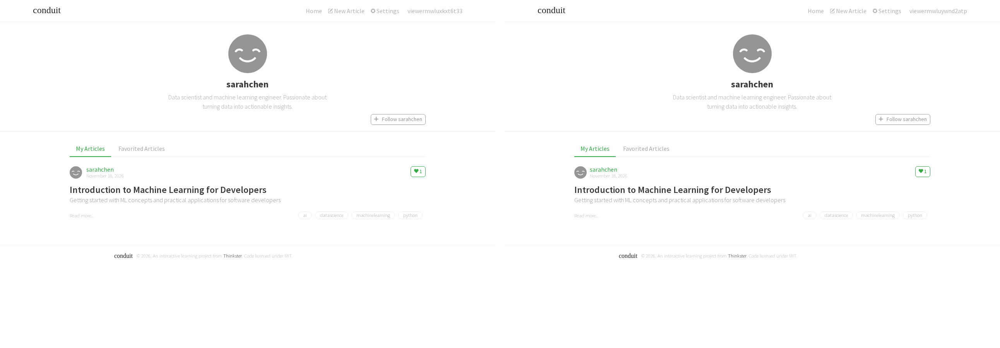

### register

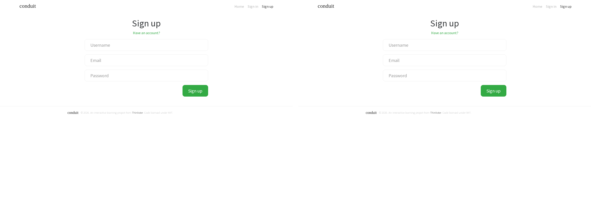

### settings

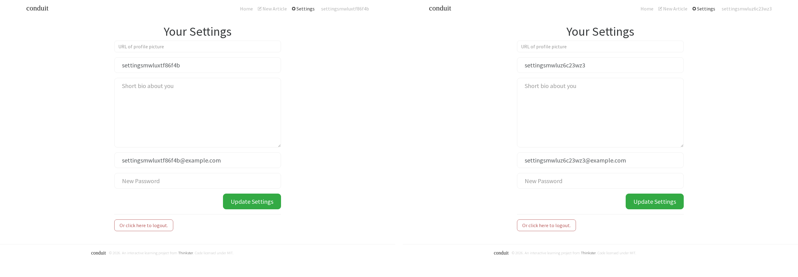

## Run

```bash
cd parity && npm ci && npx playwright install chromium
npx playwright test            # both projects (both apps must be running)
npx playwright test --project=legacy
npm run report                 # rebuilds this README and side-by-side images
```
